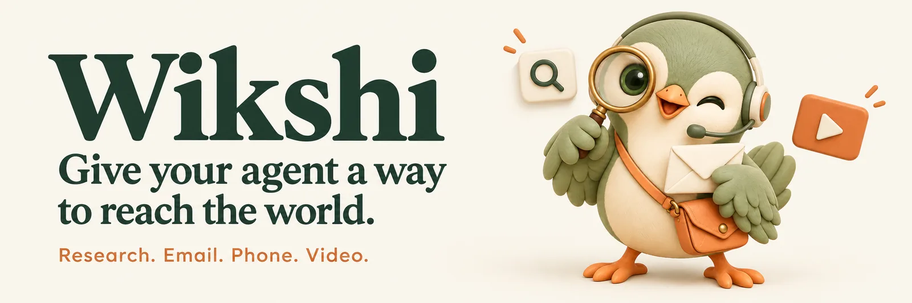
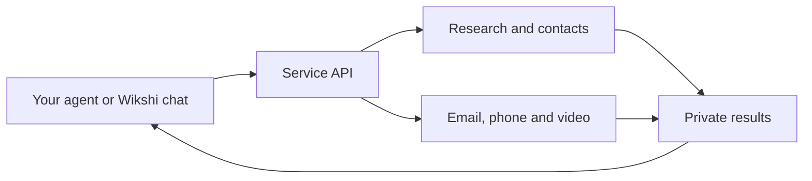

<p align="center">
  
</p>

# Give your agent a voice

Let your agent find someone, call them, send an email, or host a video meeting. Then bring the answers back.

AI can do a lot of research. But when getting an answer means actually talking to someone, you usually end up doing the work yourself. Wikshi gives agents the contact data and communication tools to handle that part too, through one integration.

[Website](https://wikshi.xyz/) · [Try Wikshi](https://wikshi.xyz/chat/) · [Agent skill](https://wikshi.xyz/wikshi/skills.md) · [API reference](https://api.wikshi.xyz/v1/docs)

## What your agent can do

| Capability | Let your agent… |
| --- | --- |
| Web research | Find people, companies, news, and hard-to-find information. Read source pages for the details. |
| Business contacts | Look up a person's work email or available phone number, find contacts at a company, or identify a business profile from an email address. |
| Email and inbox | Get its own inbox, draft messages for your review, send approved emails, read replies, and keep the conversation going. |
| Phone calls | Call someone, ask your questions, follow up on their answers, and return what was said with a transcript. |
| Video meetings | Send a guest link for an AI-hosted conversation of up to five minutes. The host asks your questions while you get on with your day. Your agent retrieves the transcript afterward. |

Ask for a work email with a name and company. The hosted agent can resolve the person's identity and continue into contact lookup in the same response. You do not need to direct each search yourself.

## One goal, several ways to get there

Suppose you need a venue for a team offsite. Your agent researches suitable places, finds the booking contacts, and drafts an inquiry with your dates and requirements. You review the email before it goes out.

When a reply leaves something unclear, the agent can call to ask about availability and pricing. If a longer conversation would help, it can email a video invitation and let an AI host walk the venue representative through your questions. You receive the replies and transcripts without having to attend every conversation.

The same tools work for supplier quotes, recruiting outreach, customer interviews, and finding the right person to talk to.

## Bring your own agent

Give your agent this prompt:

```text
Read https://wikshi.xyz/wikshi/skills.md and use Wikshi for my task.
Check which services are available. Keep credentials private, reuse existing
requests, and ask for my approval before sending messages or starting calls
and meetings. Report actual results, not assumed outcomes.
```

The [live catalog](https://api.wikshi.xyz/v1/services) describes available tools. The [agent card](https://wikshi.xyz/.well-known/agent-card.json) exposes the hosted agent through A2A. Use the service API directly when you want to control each operation from your own application.

The [chat app](https://wikshi.xyz/chat/) is a convenient way to try the capabilities. It runs requested research and contact lookups directly, while keeping draft review and approval for outreach. External clients follow the preparation and execution steps in the API reference.

## How it fits together



The API validates inputs, saves requests, and dispatches work to service adapters. Calls and meetings run asynchronously; the worker checks their status and retrieves transcripts when ready. Email replies arrive in the agent's inbox.

- Idempotency keys and durable execution records guard against duplicate actions when a client retries.
- A private credential scopes access to each caller's requests and inboxes. Sensitive stored payloads use AES-256-GCM encryption.
- The hosted agent streams tool progress and shows research records, drafts, and conversation results in its workspace.
- Contact results can be incomplete. Wikshi returns the available data rather than inventing an address or claiming a conversation succeeded.

## Development

The repository contains a Next.js landing site, a React/Vite chat app, and Node.js services for the API and hosted agent. SQLite holds durable request and inbox state.

Use Node.js 24 or newer:

```sh
npm ci
npm --prefix backend ci
npm --prefix agent-demo ci
```

Create private `.env.local` files from the examples in `backend/` and `agent-demo/`. Configure the capabilities you want to run and keep all credentials server-side. For local development, use a writable database path, a random 32-byte hex `WIKSHI_DATA_KEY`, and these chat settings:

```dotenv
WIKSHI_API_ORIGIN=http://127.0.0.1:8080
WIKSHI_CHAT_ORIGIN=http://127.0.0.1:5173
```

Run each process in a separate terminal, starting from the repository root:

```sh
# Service API
cd backend && node --env-file=.env.local src/server.mjs

# Hosted agent
cd agent-demo && npm run server

# Chat interface
cd agent-demo && npm run dev

# Landing site
npm run dev
```

The chat development server proxies requests to the hosted agent on port 8081. The service API listens on port 8080.

```sh
# Build the landing site and chat
npm run build
npm --prefix agent-demo run build

# Run chat tests
npm --prefix agent-demo test
```

In production, serve the static site and chat behind a reverse proxy, with the API and hosted agent as separate processes. Keep configuration, databases, and backups outside the web root. Real emails and calls reach real people; use consenting recipients when testing.
